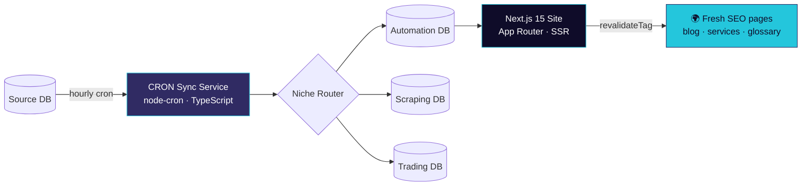

<!-- ═══════════════════════════  HEADER  ═══════════════════════════ -->
<p align="center">
  
</p>

<p align="center">
  <a href="https://github.com/HaseebAther">
    
  </a>
</p>

<p align="center">
  
  <a href="mailto:itzhaseebather@gmail.com"></a>
  <a href="https://15mhub.com"></a>
  
</p>

---

## `> whoami`

```ts
const haseeb = {
  role:        "Full-Stack Developer",
  base:        "Pakistan 🇵🇰",
  buildsWith:  ["Next.js", "React", "Node.js", "TypeScript", "PostgreSQL", "WordPress"],
  obsessedWith:["automation", "SEO at scale", "self-hosting", "systems that run while I sleep"],
  currently:   "Running a multi-niche AI content pipeline in production",
  learning:    ["Advanced JS internals", "Distributed jobs & queues", "Infra hardening"],
  funFact:     "Good code is like good humor — clean, precise, and makes people happy.",
  askMeAbout:  ["CRON pipelines", "Next.js App Router", "SSR / prerendering", "WordPress plugins"],
};
```

---

## 🛰️ Featured Builds

<table>
<tr>
<td width="50%" valign="top">

### ⚙️ CogWorkLabs — AI Content Engine
A **multi-niche content pipeline**: one template codebase that powers multiple niche sites, with AI-generated, SEO-structured articles, services and glossary pages published automatically.

- Next.js 15 App Router, flat + nested URL routing with 301 migration layer
- `postgres.js` data layer over self-hosted PostgreSQL
- Auto internal-linking, dynamic sitemaps, on-demand `revalidateTag`
- Glossary pages pre-rendered to real HTML for crawlers

`Next.js` `TypeScript` `PostgreSQL` `Prisma` `Tailwind` `Claude API`

</td>
<td width="50%" valign="top">

### ⏱️ CRON Sync Service
The **brain behind the pipeline** — a standalone TypeScript service on a VPS that syncs, transforms and fans content out to every niche database on a schedule.

- `node-cron` scheduler with run-on-startup + one-shot modes
- Per-niche config, schema push to all target DBs, migrations
- Private networking between services over WireGuard
- Python + PowerShell one-command deploy & remote health checks

`Node.js` `TypeScript` `node-cron` `WireGuard` `systemd` `Python`

</td>
</tr>
<tr>
<td width="50%" valign="top">

### 🌐 15mhub.com
A **scalable business platform** built for growth — designed, developed and shipped end to end.

<a href="https://15mhub.com"></a>

`Full-Stack` `Performance` `SEO`

</td>
<td width="50%" valign="top">

### 🧘 BodySoul Management
A **custom WordPress booking plugin** — scheduling, appointment management and admin tooling, built from scratch instead of bolted together from 10 plugins.

`WordPress` `PHP` `MySQL` `JavaScript`

</td>
</tr>
</table>

---

## 🧬 How My Pipeline Works



---

## 🧰 Arsenal

<p align="center">
  <b>Frontend</b><br/><br/>
  
</p>
<p align="center">
  <b>Backend &amp; Data</b><br/><br/>
  
</p>
<p align="center">
  <b>CMS, Infra &amp; Tooling</b><br/><br/>
  
</p>
<p align="center">
  
  
  
  
</p>

---

## 📊 GitHub Telemetry

<p align="center">
  
  
</p>

<p align="center">
  
</p>

<p align="center">
  
</p>

<p align="center">
  
</p>

---

## 🐍 Eating My Contributions

<p align="center">
  <picture>
    <source media="(prefers-color-scheme: dark)" srcset="https://raw.githubusercontent.com/HaseebAther/HaseebAther/output/github-snake-dark.svg" />
    <source media="(prefers-color-scheme: light)" srcset="https://raw.githubusercontent.com/HaseebAther/HaseebAther/output/github-snake.svg" />
    
  </picture>
</p>

---

## 🤝 Let's Build Something

<p align="center">
  <i>Need a content engine, an automation pipeline, a custom WordPress plugin, or a site that ships itself?</i><br/><br/>
  <a href="mailto:itzhaseebather@gmail.com"></a>
</p>

<p align="center">
  <b>Always Learning · Always Building · Always Optimizing</b>
</p>

<!-- ═══════════════════════════  FOOTER  ═══════════════════════════ -->
<p align="center">
  
</p>
