<p align="center">
  
</p>

<p align="center">
  <a href="https://github.com/HaseebAther">
    
  </a>
</p>

<p align="center">
  
  <a href="https://www.fiverr.com/users/haseebxather/portfolio/"></a>
  <a href="https://www.upwork.com/freelancers/~014e6c714a4eb2b22d"></a>
  <a href="mailto:itzhaseebather@gmail.com"></a>
  
</p>

---

## ▣ OPERATOR DOSSIER

```yaml
operator:     Haseeb Ather
callsign:     GHOST
role:         AI Automation Engineer // Full-Stack Developer
base:         Pakistan
primary:      [AI agents, workflow automation, Next.js, React, Node.js, TypeScript]
secondary:    [Zapier, Odoo ERP, REST APIs, PostgreSQL, WordPress, PHP]
specialty:    replacing manual work with systems that run while you sleep
confirmed:    "7-agent AI service desk · 240+ production workflows · ERP order automation"
rules_of_engagement: "Good code is like good humor — clean, precise, and makes people happy."
```

---

## ▣ COMPLETED OPERATIONS

<table>
<tr>
<td width="50%" valign="top">

#### `OP-01` &nbsp;AI Service Desk — TLC Tech
<sub>🟢 <b>STATUS:</b> DEPLOYED &nbsp;·&nbsp; <b>CLASS:</b> MULTI-AGENT AI</sub>


Seven specialized AI agents handle ticket intake, triage, data enrichment, help-desk routing and after-hours scheduling for an IT support team.

**After-action:** routing time cut from **20–30 min to ~5 min**.

`AI Agents` `Automation` `Help Desk` `Dashboards`

</td>
<td width="50%" valign="top">

#### `OP-02` &nbsp;AI B2B Order Processing — The Unscented Company
<sub>🟢 <b>STATUS:</b> DEPLOYED &nbsp;·&nbsp; <b>CLASS:</b> AI + ERP</sub>


PDF and email purchase orders are read by AI, extracted, validated and turned into sales orders in Odoo automatically. No more manual order entry.

**After-action:** less admin work, fewer entry errors, a workflow that scales.

`AI Extraction` `Odoo ERP` `Email + PDF` `Automation`

</td>
</tr>
<tr>
<td width="50%" valign="top">

#### `OP-03` &nbsp;LawHQ — E-Signature & Document Suite
<sub>🟢 <b>STATUS:</b> DELIVERED &nbsp;·&nbsp; <b>CLASS:</b> FULL-STACK PLATFORM</sub>


A custom DocuSign alternative for a law firm: edit documents, request and collect signatures, verify signed files, with full audit logs and automated notifications.

**After-action:** one secure platform instead of a stack of third-party tools.

`Full-Stack` `E-Signature` `Audit Logs` `Notifications`

</td>
<td width="50%" valign="top">

#### `OP-04` &nbsp;Laudable — Workflow Automation
<sub>🟢 <b>STATUS:</b> DELIVERED &nbsp;·&nbsp; <b>CLASS:</b> AUTOMATION AT SCALE</sub>


**240+ Zapier workflows** connecting SaaS tools and APIs across onboarding, lead management, sales pipeline, marketing and internal ops, plus API integrations and rapid prototypes.

**After-action:** the team focuses on growth, not copy-paste admin.

`Zapier` `API Integrations` `SaaS` `Prototyping`

</td>
</tr>
</table>

<p align="center">
  <a href="https://www.fiverr.com/users/haseebxather/portfolio/"></a>
  <a href="https://www.upwork.com/freelancers/~014e6c714a4eb2b22d"></a>
</p>

---

## ▣ MISSION BRIEFING

<p align="center">
  
</p>

---

## ▣ LOADOUT

<p align="center">
  <br/>
  <br/>
  
</p>
<p align="center">
  
  
  
  
</p>

---

## ▣ COMBAT RECORD

<p align="center">
  
  
</p>

<p align="center">
  
</p>

<p align="center">
  
</p>

---

## ▣ RECON SWEEP

<p align="center">
  <picture>
    <source media="(prefers-color-scheme: dark)" srcset="https://raw.githubusercontent.com/HaseebAther/HaseebAther/output/github-snake-dark.svg" />
    <source media="(prefers-color-scheme: light)" srcset="https://raw.githubusercontent.com/HaseebAther/HaseebAther/output/github-snake.svg" />
    
  </picture>
</p>

---

## ▣ REQUEST EXTRACTION

<p align="center">
  <i>Drowning in manual tickets, orders or copy-paste workflows? Call in an airstrike of automation.</i><br/><br/>
  <a href="https://www.fiverr.com/users/haseebxather/portfolio/"></a>
  <a href="https://www.upwork.com/freelancers/~014e6c714a4eb2b22d"></a>
  <a href="mailto:itzhaseebather@gmail.com"></a>
</p>

<p align="center">
  
</p>
